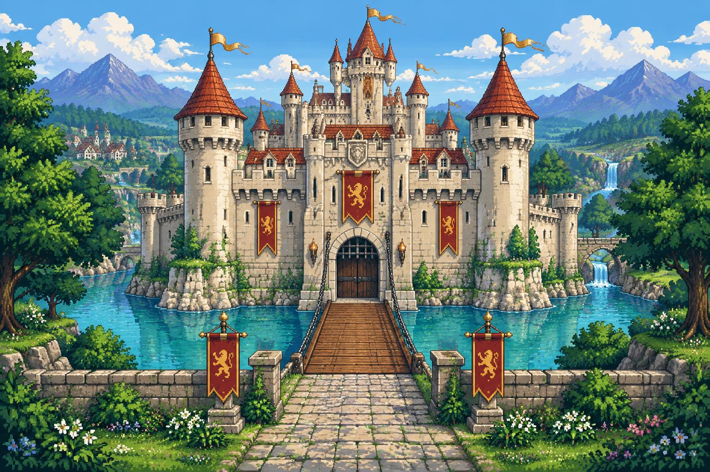

# Portfólio RPG — Henrique Santos de Souza

Portfólio interativo em formato de RPG de castelo, com uma jornada por cinco salas que apresentam formação, habilidades, projetos, certificações e contato profissional.



---

## Demo

```
https://henriquesouza.vercel.app/
```

---

## Design

O design system, wireframes e user flow do projeto estão documentados em:

```
wireframe/wireframe, userflow e design system.pdf
```

A página `/design` da aplicação também serve como guia vivo de tokens, cores, tipografia e componentes.

---

## Funcionalidades

- **Tela do castelo** — suporta dois modos: renderização 3D com Three.js / WebGL2 (modelo GLB animado com torres, muralhas, portão, bandeiras e árvores que balançam) ou imagem estática com shader GLSL de vento. O modo é detectado automaticamente pela disponibilidade de WebGL2; há fallback gracioso em caso de perda de contexto.
- **Mapa do castelo** — planta SVG vetorial com cinco salas navegáveis; herói animado percorre rotas calculadas por grafo com Dijkstra. Navegação por teclado com setas e Enter.
- **Salas mobiliadas** — cada sala tem móveis desenhados em SVG pixel art; o herói caminha até o objeto selecionado via pathfinding A\* em grid 20×14.
- **Estante da biblioteca** — livros clicáveis com painel de detalhes; categorias Cursos, Certificados (PDFs linkados) e Projetos (GitHub ao vivo).
- **Esfera de tecnologias** — globo 3D interativo (Three.js) com as tecnologias do perfil como nós coloridos por categoria. Fallback para lista filtrável quando WebGL não está disponível ou `prefers-reduced-motion` está ativo.
- **Repositórios GitHub ao vivo** — script de pré-build (`fetch:github`) grava um snapshot JSON; no runtime um fetch ao vivo é tentado e, em caso de falha, o snapshot é servido como fallback.
- **Mensageiro** — formulário de contato integrado ao e-mail via `formsubmit.co`, com links para GitHub e LinkedIn.
- **Deep links** — cada sala tem uma URL própria via hash (`#biblioteca`, `#sala-do-trono`, etc.); o browser back/forward funciona normalmente.
- **Versão simples** — modo sem animações, acessível via botão "Pular o jogo" ou hash `#simples`, com todo o conteúdo em HTML semântico.
- **Alternância de idioma PT/EN** — toda a interface, incluindo nomes de salas, descrições e templates de e-mail, muda instantaneamente. Preferência salva em `localStorage`.
- **Alternância de tema claro/escuro** — preferência salva em `localStorage`; tokens CSS reativos (sky, grass, water do modelo 3D incluídos).
- **Achievement de explorador** — toast desbloqueado ao visitar as cinco salas; estado salvo em `localStorage` para não repetir.
- **Efeito typewriter** — descrições de artefatos são digitadas letra a letra ao abrir o popup; desativado com `prefers-reduced-motion`.
- **Popup arrastável** — o painel de detalhes pode ser reposicionado livremente (em telas ≥ 640 px).
- **Reduced motion** — detecta `prefers-reduced-motion: reduce` e substitui todas as animações por transições instantâneas.
- **Acessibilidade** — foco gerenciado entre telas, `aria-live` para anúncios de navegação, `aria-label` em todos os controles, navegação por teclado completa, Escape para voltar.
- **Página de design** — rota `/design` expõe o design system vivo (tokens, cores, tipografia, componentes).

---

## Arquitetura

```
main.tsx
  ├── /design → DesignPage
  └── /* → App
            └── Portfolio (src/components/rpg/portfolio.tsx)
                  ├── [castle screen]
                  │     └── CastleView
                  │           ├── CastleWorld3D   — Three.js (WebGL2)
                  │           └── WindScene       — shader GLSL (fallback)
                  ├── [map screen]
                  │     ├── CastleMap             — SVG da planta
                  │     └── Hud                   — salas visitadas
                  ├── [room screen]
                  │     ├── RoomScene             — sala + herói posicionado
                  │     ├── Popup (arrastável)
                  │     │     ├── ShelfView       — estante de livros
                  │     │     ├── Messenger       — formulário de contato
                  │     │     └── TechSphere      — globo 3D (lazy)
                  │     └── TechSearch            — busca de tecnologias
                  └── [simple screen]           — HTML semântico sem animações
```

**Fluxo de estado** — `Portfolio` gerencia tudo com `useState`. Não há store global. As transições de tela são controladas por um token de operação (`useRef<number>`) que cancela animações assíncronas ao trocar de tela.

**Roteamento** — hash-based sem biblioteca de rotas. `parseHash`/`formatHash` em `lib/deep-link.ts` mapeiam hashes para salas; `history.replaceState` mantém a URL sincronizada. A rota `/design` é resolvida em `main.tsx` antes da montagem do React.

---

## Estrutura de pastas

```
portfolio-rpg/
├── wireframe/
│   └── wireframe, userflow e design system.pdf
├── reference/
│   ├── Design system_ Portfólio RPG.html
│   └── Portfólio RPG_ user flow e wireframes.html
├── public/
│   ├── icons.svg
│   ├── favicon.svg
│   └── models/
│       └── castle-3d/          # GLBs: towers, walls, gate, trees, rocks
├── scripts/
│   └── fetch-github-projects.mjs  # pré-build: grava src/data/github-projects.json
├── curriculo/
│   ├── Curriculo_Henrique_Santos_de_Souza.docx
│   └── Henrique_Santos_de_Souza_Resume_EN.docx
├── certificados/               # PDFs linkados na estante de certificados
└── src/
    ├── app/
    │   ├── App.tsx              # Wrapper fino sobre <Portfolio>
    │   ├── App.test.tsx
    │   ├── main.tsx             # createRoot + roteamento /design
    │   └── design/
    │       └── DesignPage.tsx   # Guia vivo de design system
    ├── assets/
    │   └── castle.jpg
    ├── components/
    │   └── rpg/
    │       ├── arsenal/
    │       │   └── tech-search.tsx          # Busca filtrável de tecnologias
    │       ├── castle3d/
    │       │   ├── castle-assets.ts         # URLs dos GLBs
    │       │   ├── castle-view.tsx          # Orquestrador 3D/imagem + fallback
    │       │   └── castle-world-3d.tsx      # Cena Three.js completa
    │       ├── map/
    │       │   ├── castle-map.tsx           # SVG da planta completa
    │       │   ├── furniture.tsx            # Primitivos SVG reutilizáveis
    │       │   ├── palette.ts               # Cores das salas
    │       │   └── room-furnishings.tsx     # Um componente por sala
    │       ├── tech-sphere/
    │       │   ├── tech-sphere.tsx          # Globo 3D + fallback lista
    │       │   └── SkillsGlobeAdapter.tsx   # Adapter para biblioteca de globo
    │       ├── ui/
    │       │   └── button.tsx               # Button com CVA (pixel/parchment/…)
    │       ├── art.tsx                      # Hero, ObjectArt (20+ ícones), Crest
    │       ├── explorer-achievement.tsx     # Toast de conquista
    │       ├── hud.tsx                      # HUD de salas visitadas
    │       ├── lang-toggle.tsx              # Botão PT/EN
    │       ├── messenger.tsx                # Formulário de contato
    │       ├── popup.tsx                    # Modal arrastável
    │       ├── portfolio.tsx                # Componente principal (toda a lógica)
    │       ├── room-scene.tsx               # Sala mobiliada + herói posicionado
    │       ├── shelf-view.tsx               # Estante de livros clicáveis
    │       ├── theme-toggle.tsx             # Botão claro/escuro
    │       ├── typewriter-description.tsx   # Efeito de digitação
    │       └── wind-scene.tsx               # Shader GLSL de vento (fallback 2D)
    ├── data/
    │   └── github-projects.json             # Snapshot pré-buildado dos repositórios
    ├── hooks/
    │   ├── use-draggable.ts    # Lógica de drag para popup
    │   ├── use-github-books.ts # Live fetch + fallback snapshot
    │   ├── use-lang.tsx        # LangProvider + localStorage
    │   ├── use-theme.ts        # Tema claro/escuro + localStorage
    │   └── use-typewriter.ts   # Animação de texto letra a letra
    ├── lib/
    │   ├── castle-plan.ts      # Coordenadas SVG, grafo de rotas, Dijkstra
    │   ├── contact.ts          # githubUrl, linkedinUrl, mailtoUrl
    │   ├── deep-link.ts        # parseHash / formatHash
    │   ├── github.ts           # GitHub API client
    │   ├── i18n.ts             # Dicionário PT/EN completo
    │   ├── portfolio-data.ts   # Tipos, mapa ASCII, findPath (A*), rooms[], profile
    │   ├── room-layouts.ts     # Fixtures por sala, roomGrid, roomEntrance
    │   ├── tech-search.ts      # Lógica de busca de tecnologias
    │   ├── theme.ts            # Persistência e aplicação de tema
    │   ├── utils.ts            # cn() — clsx + tailwind-merge
    │   └── webgl.ts            # canUse3D() — probe de WebGL2 + saveData
    ├── test/
    │   └── setup.ts            # jest-dom + mocks de matchMedia e scrollTo
    └── styles.css              # Tailwind v4 + design tokens + classes do portfólio
```

---

## Pré-requisitos

- **Node.js** ≥ 20
- **npm** ≥ 10

---

## Instalação e uso

```bash
# 1. Clone o repositório
git clone https://github.com/henriquessouzas/portfolio-rpg.git
cd portfolio-rpg

# 2. Instale as dependências
npm install

# 3. Inicie o servidor de desenvolvimento
npm run dev
```

Abra `http://localhost:5173` no navegador. Clique em **Entrar no castelo**, navegue pelo mapa e explore as salas.

### Build de produção

```bash
npm run build     # fetch:github → tsc -b → vite build → dist/
npm run preview   # serve dist/ localmente para inspeção
```

> O script `prebuild` chama `fetch:github` automaticamente antes de cada build. Para rodar manualmente: `npm run fetch:github`.

---

## Scripts disponíveis

| Script | Descrição |
|---|---|
| `npm run dev` | Servidor de desenvolvimento com HMR (Vite) |
| `npm run build` | Fetch GitHub → typecheck → build de produção em `dist/` |
| `npm run preview` | Serve o build de produção localmente |
| `npm run typecheck` | Checagem de tipos sem emitir arquivos |
| `npm run lint` | ESLint em `src/` |
| `npm run format` | Prettier em `src/` |
| `npm run test` | Vitest em modo run (CI) |
| `npm run test:watch` | Vitest em modo watch (desenvolvimento) |
| `npm run fetch:github` | Atualiza `src/data/github-projects.json` manualmente |

---

## Stack e dependências

### Runtime

| Pacote | Versão | Uso |
|---|---|---|
| `react` + `react-dom` | ^19 | UI |
| `three` | ^0.186 | Cena 3D do castelo e globo de tecnologias |
| `@react-three/fiber` | ^9 | Renderer React para Three.js |
| `@react-three/drei` | ^10 | Helpers: OrbitControls, useGLTF, Environment… |
| `tailwindcss` | ^4.3 | Estilos utilitários |
| `class-variance-authority` | ^0.7 | Variantes do Button |
| `clsx` + `tailwind-merge` | ^2 / ^3 | Utilitário `cn()` |
| `@radix-ui/react-slot` | ^1.2 | `asChild` no Button |
| `lucide-react` | ^0.575 | Ícones |
| `pathfinding` | ^0.4 | A\* nas salas |
| `react-i18next` | ^17 | Base para o sistema de i18n (PT/EN) |
| `tw-animate-css` | ^1.3 | Animações CSS adicionais |

### Dev

| Pacote | Versão | Uso |
|---|---|---|
| `vite` | ^8 | Bundler |
| `@vitejs/plugin-react` | ^6 | JSX transform (Oxc) |
| `@tailwindcss/vite` | ^4.3 | Plugin Tailwind para Vite 8 |
| `typescript` | ~6.0 | Tipagem estática |
| `eslint` + `typescript-eslint` | ^10 / ^8 | Lint |
| `oxlint` | ^1.81 | Linter Rust complementar |
| `eslint-plugin-react-hooks` | ^7 | Regras de hooks |
| `prettier` | ^3 | Formatação |
| `vitest` | ^5 | Testes unitários |
| `@testing-library/react` | ^16 | Render em testes |
| `jsdom` | ^30 | Ambiente DOM nos testes |

---

## Personalização do conteúdo

O conteúdo está centralizado em **`src/lib/portfolio-data.ts`**. Edite o objeto `profile` e o array `rooms`:

```ts
// src/lib/portfolio-data.ts

export const profile: Profile = {
  name: 'Seu Nome',
  email: 'seu@email.com',
  github: 'seu-usuario',
  linkedin: 'https://linkedin.com/in/seu-perfil',
  cv: {
    pt: '/curriculo/curriculo-pt.docx',
    en: '/curriculo/resume-en.docx',
  },
  githubFeatured: ['repo-destaque-1', 'repo-destaque-2'],
  githubExclude: ['repositorio-privado'],
  githubOverrides: {
    'portfolio-rpg': { title: 'Portfólio RPG' },
  },
  technologies: [
    { name: 'TypeScript', category: 'Linguagens', years: 3 },
    // ...
  ],
  // ...
};
```

As salas `rooms` e `roomsEn` têm a mesma estrutura — edite ambas para manter PT e EN sincronizados.

**Campos de cada `Artifact`:**

| Campo | Tipo | Descrição |
|---|---|---|
| `name` | `string` | Nome do objeto na sala |
| `title` | `string` | Título no painel de detalhes |
| `description` | `string` | Texto descritivo |
| `tags` | `string[]` | Tags exibidas como badges |
| `art` | `string` | Ícone SVG (ver lista abaixo) |
| `paragraphs?` | `string[]` | Parágrafos extras no painel |
| `items?` | `string[]` | Lista de itens no painel |
| `links?` | `{ label, url, download? }[]` | Links de ação |
| `books?` | `Book[]` | Abre a estante de livros |
| `categories?` | `TechnologyCategory[]` | Filtra tecnologias no orb |

**Ícones disponíveis** (`art`): `sword`, `shield`, `bow`, `anvil`, `book`, `books`, `scroll`, `throne`, `trophy`, `letter`, `bed`, `desk`, `poster`, `chest`, `potion`, `flask`, `cauldron`, `orb`.

---

## Acessibilidade

- Navegação por teclado completa: **setas** movem o herói no mapa, **Enter** entra na sala sob o herói, **Escape** volta à tela anterior ou fecha o popup.
- Foco movido programaticamente para o `<h1>` de cada nova tela.
- `role="status"` com `aria-live="polite"` anuncia destinos e objetos para leitores de tela.
- `aria-label` em todos os botões de sala, objeto e controles de navegação.
- `aria-pressed` nos botões de sala do mapa indica o destino atual.
- Modo **Pular o jogo** expõe todo o conteúdo em HTML semântico sem animações.
- `prefers-reduced-motion: reduce` desativa o modelo 3D, o shader de vento, o globo de tecnologias, as animações do herói, o efeito typewriter e as transições de tela.

---

## Decisões técnicas

### Castelo 3D com Three.js
`castle-view.tsx` sonda WebGL2 criando um canvas temporário antes de montar a cena. Se disponível, carrega `castle-world-3d.tsx` via `lazy()`. A cena lê tokens CSS (`--castle-sky`, `--castle-grass`, etc.) para tematizar o céu, a grama e a água em tempo real com um `MutationObserver` no `<html>`. Em caso de `webglcontextlost` ou erro do `ErrorBoundary`, o componente desmonta silenciosamente e o `WindScene` (shader 2D de fallback) é exibido.

### Shader GLSL de vento (fallback 2D)
`wind-scene.tsx` aplica deslocamento de textura localizado sobre `castle.jpg`: foliagem e bandeiras têm máscaras independentes (`patch` e `cloth`), enquanto a alvenaria permanece estática. O canvas só é exibido após o primeiro frame (`element.dataset['ready']`), evitando flash.

### Pathfinding em dois níveis
- **Mapa do castelo** (`castle-plan.ts`) — grafo de nós com Dijkstra. Adequado para o espaço contínuo do SVG 640×520 com poucas salas e portas.
- **Interior das salas** (`portfolio-data.ts` + `room-layouts.ts`) — grid 20×14 com A\* (`pathfinding` npm). Adequado para o espaço discreto com móveis como obstáculos.

### Cancelamento assíncrono por token
Funções como `goToRoom` e `pickObject` são `async` com loops de animação via `await pause()`. Um `useRef<number>` incrementado a cada nova operação permite cancelamento silencioso sem `AbortController`.

### GitHub ao vivo + snapshot
`scripts/fetch-github-projects.mjs` roda no `prebuild` e grava `src/data/github-projects.json`. `use-github-books.ts` usa esse arquivo como seed imediato e dispara um fetch live; se o live falhar, o snapshot garante que os projetos sempre aparecem.

### Tailwind v4 com Vite 8
`@tailwindcss/vite` v4.3+ é necessário para compatibilidade com Vite 8 (`peer vite: "^5.2.0 || ^6 || ^7 || ^8"`).

### TypeScript 6 e `baseUrl`
`baseUrl` está marcado como deprecated no TypeScript 6 quando usado com `paths`. O projeto usa `"ignoreDeprecations": "6.0"` para manter a configuração funcional até migração completa.

---

## Licença

MIT © 2026 Henrique Santos de Souza
